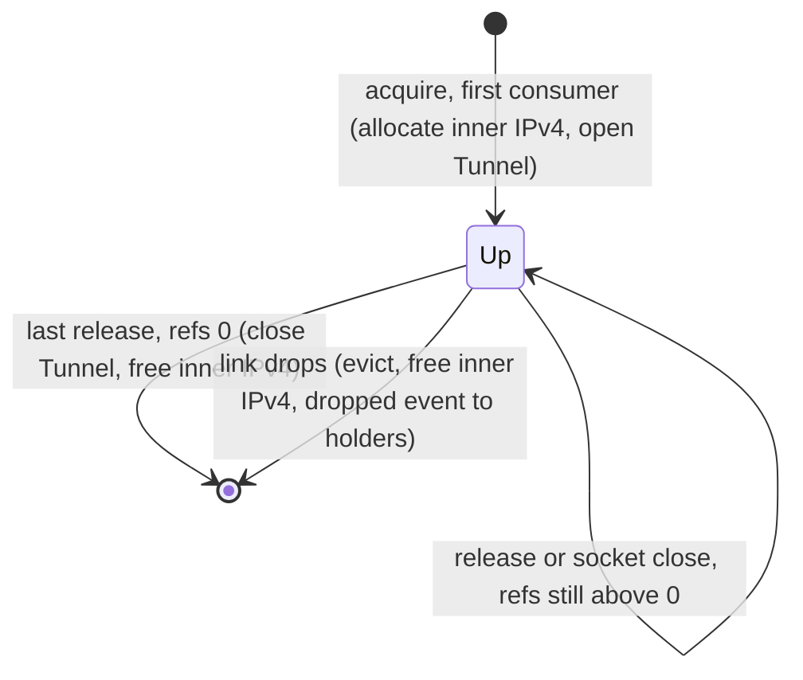
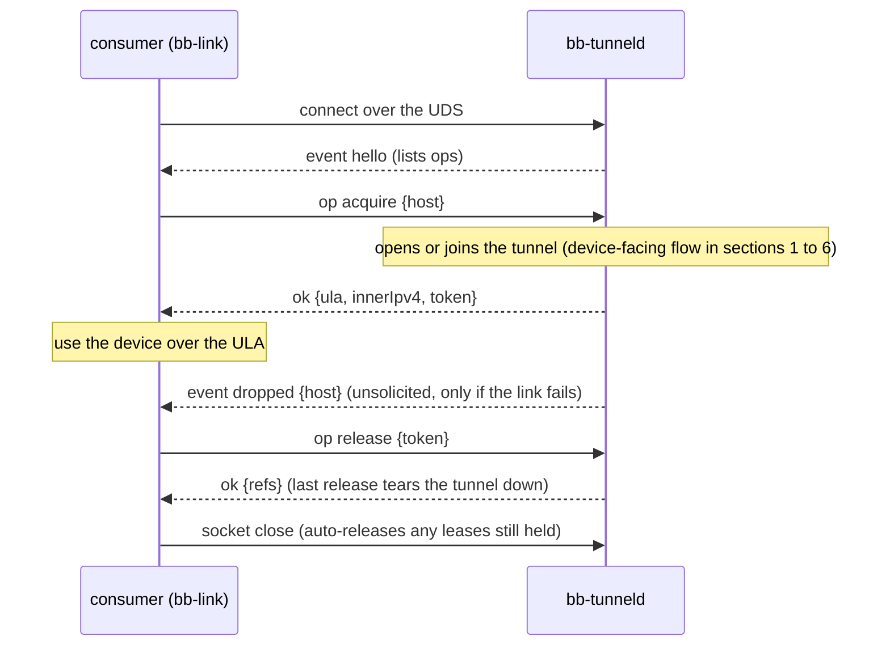

# bb-tunnel — BlackBerry bp2p Wi-Fi tunnel protocol

The wire protocol `bb-tunnel` speaks to bring up the BlackBerry 10 **bp2p Wi-Fi tunnel** and carry IP
over it. Lifted from the source javadoc into a standalone reference. For build/run/API, see
[`README.md`](README.md); the broader investigation and certificate guide live in the project's
`analysis/` docs.

> **Access requires pairing, not just this protocol.** Completing the handshake below needs a client
> certificate the **device already trusts** — i.e. one enrolled by pairing with BlackBerry Link and/or
> Blend. The tunnel comes up and routes only for an enrolled peer; the certificate alone is not enough.
> See [`README.md`](README.md#device-pairing-is-required) and §4.

---

## 1. Transport stack (bottom to top)

1. **TLS 1.0 control channel** — TCP to `device:1111` (the advertised `_tunnel._tcp` port), mutual-auth,
   cipher **`0xC005`** (ECDH-ECDSA-AES256-CBC-SHA), curve **secp521r1 (P-521)**. Carries the command
   protocol (§2).
2. **DTLS 1.0 data channel** — UDP to a per-session port the control channel hands back, same
   mutual-auth certificate and cipher. After the handshake it carries IP packets, each prefixed by a
   2-byte channel tag (§3).
3. **utun** — on macOS a `utun` interface bridges the OS IP stack to the DTLS channel, so ordinary
   sockets reach the device's services at `[deviceULA]:<port>` (§4).

Both TLS and DTLS are **1.0** with the static-ECDH `0xC005` cipher on P-521 — dropped by OpenSSL
1.1+/3.x, so a library that still supports them is required (bb-tunnel uses BouncyCastle; see §6).

## 2. Control command protocol (TLS :1111)

### 2.1 Framing

Every command is `[0x00][cmd][u16 len][payload]` on the TLS stream (`len` big-endian, payload length).
Responses use the same framing with the response command id. Async **NOTIFY** (`0x05`) frames may
arrive at any time and are skipped; an **ERROR** (`0x04`) frame aborts.

| cmd    | name         | resp   | notes                                                                                       |
|--------|--------------|--------|---------------------------------------------------------------------------------------------|
| `0x00` | INIT         | `0x01` | fixed 8-byte body `24 05 20 03 00 01 00 00`; the device echoes it.                          |
| `0x02` | CONNECT      | `0x03` | 20-byte body `[16B our ULA][u16 our UDP port][00 01]`.                                      |
| `0x0a` | IPV4_INQUIRE | `0x0b` | queries IPv4 sub-protocol state.                                                            |
| `0x08` | IPV4_DISABLE | `0x09` | —                                                                                           |
| `0x06` | IPV4_ENABLE  | `0x07` | carries our / device inner IPv4 (`169.254/16`); the device binds its inner IPv4 to `bptp0`. |
| `0x05` | NOTIFY       | —      | async; skipped.                                                                             |
| `0x04` | ERROR        | —      | aborts.                                                                                     |

### 2.2 Sequence

1. **INIT** (`0x00`) → **INIT_RESP** (`0x01`): the device echoes the fixed 8-byte body.
2. **CONNECT** (`0x02`) → **CONNECT_RESP** (`0x03`):
    - Request body (20 B): `[16B our ULA][u16 our UDP port][00 01]`. **Our ULA** is derived from the
      client certificate (§4); it is the identity the device verifies and routes back to, so it must
      match the enrolled cert.
    - Response body: `[16B device ULA][u16 DTLS data port][u16 flags]`. The **device ULA** (stable
      across sessions) and the **per-session DTLS port** are read here — neither is hardcoded.
3. **IPv4 sub-protocol** (the SMB network drive): `IPV4_INQUIRE` (`0x0a`) → `0x0b`, then
   `IPV4_DISABLE` (`0x08`) to clear stale state and `IPV4_ENABLE` (`0x06`) carrying our and the
   device's inner IPv4 — both from link-local `169.254.0.0/16` (the device validates that prefix).
   The device binds its inner IPv4 to `bptp0`, so its SMB share (smbd, bound to `bptp0`) becomes
   reachable at `[deviceIpv4]:445` over the tunnel; the client assigns its own inner IPv4 to the utun (§3). This
   address — the **SMB host** — is exposed by `Tunnel.deviceIpv4()` and is now returned to
   callers as part of the SMB credential after login, so a client has what it needs to mount
   `smb://[deviceIpv4]/<share>`.

   > **Per-device inner IPv4 (multi-device).** The pair is **allocated per device** by `TunnelManager`
   > from an `InnerAddressPool`: each device gets a distinct `169.254.k.1/.2` (`k = 2,3,…`), so several
   > devices can use the IPv4/SMB plane at once without colliding. A single-device or external-app mount
   > takes the pinned stable pair `169.254.1.1/.2` (`acquire(host, true)`), so that SMB address stays
   > constant. The pool reserves `169.254.0.0/30` (USB NCM) and the RFC-3927 first/last `/24`; the
   > device accepts any `169.254.0.0/16` address (verified — it bound `169.254.9.1`). The device also
   > reports its occupied subnets in the `IPV4_INQUIRE` (`0x0b`) response — a `u16` count then
   > `(u32 address, u32 mask)` pairs (e.g. `127.0.0.1/8`, the Wi-Fi LAN, `169.254.0.1/30`) — which the
   > pool can consult for dynamic avoidance (today the static reservations already cover the only
   > link-local overlap).
4. **Data channel**: dial UDP to `device:<DTLS port>` and run the DTLS 1.0 mutual-auth handshake with
   the same certificate/cipher. The tunnel is then live (§3).

## 3. Data channel (DTLS :<session port>)

After the DTLS handshake the channel carries IP packets, each prefixed by a **2-byte channel tag**:

| tag      | meaning                    |
|----------|----------------------------|
| `0x0001` | IPv6 packet                |
| `0x0002` | control / ping (keepalive) |
| `0x0003` | IPv4 packet                |

- **utun bridge**: inbound `0x0001`/`0x0003` payloads are written to the utun (2-byte tag stripped);
  outbound IP packets from the utun are tagged and sent over DTLS. IPv6 multicast is dropped.
- **Keepalive**: roughly every 2 s the client sends an unsolicited IPv6 Neighbour Advertisement for its
  own ULA (tag `0x0001`) so the device keeps a neighbour entry and routes return traffic back through
  the tunnel. A `RimPacket` PING reply holds the data gate open.

## 4. Identity & certificates (the crux)

**One self-signed EC P-521 certificate** is used for *everything*: the TLS and DTLS mutual auth, and —
via its SHA-1 — the tunnel identity.

- **Our ULA** is derived from the certificate DER:
  ```
  ULA = 0xfd | prefix[5] | SHA1( prefix[5] || SHA1(certDER) )[10:20]
  ```
  The 5 prefix bytes are free (this client uses zero). The device recomputes the same value from the
  cert it trusts and routes return traffic to it — so the cert presented on the handshake **must be the
  one the device has enrolled**.
- **Device ULA** is not computed; it is returned in `CONNECT_RESP` (§2.2).

**The certificate alone is not sufficient for access.** The device only completes the handshake and
routes for a peer whose certificate is in its bp2p trust store — which is written **by pairing** (Link
via `pairing.cgi`, Blend via the `/pairing/pair` exchange), where the cert is inserted into
`/var/bp2p/trustedpeers` + `certSync.db`. The identity is `tunnel_cert.pem`, made and enrolled by
pairing (see the README); **pairing is what makes the device trust it.** After the tunnel is up, authenticated
device services add their own gates on top (e.g. the device-manager CGIs validate their own client
identity; Blend adds a password/`authi` session) — see the `analysis/` docs.

## 5. What a replacement client reproduces

Only two pieces are environment-specific:

- **utun** (`TunDevice`) — macOS-specific; swap for the host's TUN API on another OS.
- **TLS/DTLS 1.0 + `0xC005` + P-521** — use a crypto library that still supports them (mbedTLS,
  wolfSSL, or OpenSSL 1.0.2); OpenSSL 1.1+/3.x dropped `0xC005`.

Everything else — the command framing, the CONNECT identity derivation, the channel tags, the
keepalive — is plain bytes and portable.

## 6. Note on the device's certificate

The device presents a malformed **v1-with-extensions** certificate that strict X.509 parsers reject;
bb-tunnel re-encodes it as v3 (`LenientCrypto`) so the handshake proceeds. This is about *accepting the
device's* cert, independent of *our* identity cert above.

## 7. Tunnel broker daemon (local Unix-domain socket)

Everything above is the *device-facing* tunnel. The **broker daemon** (`bb-tunnel serve`) is the *consumer-facing* side:
a local control protocol that lets bb-link and Blend share one tunnel per
device without owning its lifecycle. It runs over a **Unix-domain socket** (default
`/tmp/bb-tunneld.sock`), **not** the network. The design and rationale are in
[`../analysis/TUNNEL-BROKER-DAEMON-PLAN.md`](../analysis/TUNNEL-BROKER-DAEMON-PLAN.md); the client is
`com.jbraddockm.core.tunnel.TunnelBrokerClient` in bb-core.

**Framing.** One JSON object per line (`\n`-terminated), UTF-8, like the bb-link daemon. A request is
`{"id":N,"op":"…","params":{…}}`; its reply echoes the `id` and is either `{"id":N,"ok":true,…}` or
`{"id":N,"ok":false,"error":{"code":"…","message":"…"}}`. On connect the daemon sends an unsolicited
`{"event":"hello","protocol":1,"tool":"bb-tunneld","version":"…","ops":[…]}`.

**Requests.**

| op         | params                                                                  | reply (on `ok`)                                                     |
|------------|-------------------------------------------------------------------------|---------------------------------------------------------------------|
| `acquire`  | `host` **or** `guid`; optional `stable` (pin `169.254.1.1`), `consumer` | `token`, `host`, `ula`, `innerIpv4`, `guid?`, `pin?`, `refs`        |
| `release`  | `token`                                                                 | `refs` (remaining for the device)                                   |
| `status`   | optional `host`                                                         | `tunnels`: `[{host,state,ula,innerIpv4,guid?,pin?,refs,consumers}]` |
| `identify` | `host`, `guid`, optional `pin`                                          | `ok`                                                                |

`acquire` opens the tunnel if it is not up (blocking on the slow P-521 bring-up) or joins and
ref-counts the existing one; the `guid` form rejoins a device the daemon has already recorded. The
daemon **cannot read `discovery.cgi` itself** (that is reachable only over the tunnel, by a consumer),
so a consumer that has learned a device's GUID/PIN reports them with `identify`; that populates the
`guid → host` map behind the `acquire {guid}` form and fires an `identity` event to the device's other
consumers.

**Events (server-initiated, unsolicited).**

- `{"event":"dropped","host":"…","cause":"…"}` — the tunnel failed on its own; sent to every
  connection holding the device. A consumer surfaces this as "tunnel down".
- `{"event":"identity","host":"…","guid":"…","pin":"…"}` — another consumer identified the device.

**Lifecycle.** A hold is scoped to the connection that made it: when a client's socket closes — clean
or crashed — the daemon releases that connection's leases, so a dead client cannot pin a tunnel up.

Lifecycle of a device's tunnel (one per device, ref-counted):



**Socket access.** Launched with `sudo` the daemon runs as root, so an unprivileged consumer could not
connect to the default root-owned `0755` socket (connecting to a Unix socket needs write permission).
On bind the daemon hands the socket to the real invoking user (`SUDO_USER`, mode `0600`), falling back
to local-user-accessible if that cannot be done; not under sudo it already runs as the connecting user.

**Example.** The daemon fronts the whole device-facing flow above; a consumer never speaks the tunnel
protocol itself. Start the daemon, then let bb-link bring a tunnel up from a device's Wi-Fi LAN address
**[verified]**:

```sh
sudo ./build/bb-tunnel serve                                   # the broker, on /tmp/bb-tunneld.sock
./bblink connect --host 192.168.1.118 --tunnel --device 2C1E7583
```

bb-link `acquire`s the tunnel over the socket, connects to the device over the returned ULA, and takes
the SMB host from the lease — so the device's CGIs, WebDAV, Blend and SMB share are all reachable from
the Wi-Fi LAN address, without the user ever handling the ULA.

Over the socket, that exchange is:


